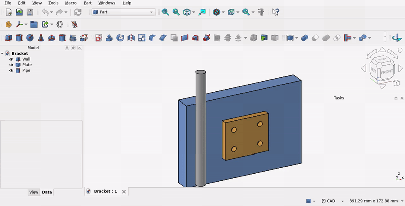

# TurnAround

A macro for FreeCAD that turns the view to the backside of your model and hides everything you have not selected. The next run turns the view back and shows the hidden objects again.

This makes it easy to select faces, edges and points on the backside of a body, without other parts getting in the way.



*The back face of the plate is covered by the wall. With TurnAround both faces are selected, and FreeCAD's quick measure in the status bar shows the thickness.*

## How to use it
1. Select something, e.g. a face of a body.
2. Run TurnAround. The view turns by 180 degrees and all other objects disappear.
3. Select what you need on the backside. Add to the selection with [Ctrl] as usual.
4. Run TurnAround again. The view turns back and all hidden objects reappear.

Without a selection, TurnAround only turns the view.

TurnAround turns around the axis that appears most vertical on the screen, so the model stays upright.

**What stays visible:** the selected objects, the containers holding them (e.g. the Part and the Body of a selected face) and, if you select a container, everything inside it.

If you deselect everything before the second run, the hidden objects reappear right away.

## Assign a shortcut
TurnAround is a real time-saver with a shortcut:
1. Tools -> Customize... -> tab **Macros**.
2. Choose `TurnAround.FCMacro`, enter a menu text, the icon `TurnAroundIcon.png` and a shortcut.
3. Click **Add**. Now you can also put TurnAround on a toolbar in the **Toolbars** tab.

## Installation
Copy `TurnAround.FCMacro` and `TurnAroundIcon.png` into your FreeCAD macro folder. Type `App.getUserMacroDir(True)` into FreeCAD's Python console to find it.

## Settings
At the top of the macro:
* `Rotations`: runs for a full turn. `2` turns by 180 degrees (default), `3` by 120 degrees, `4` by 90 degrees. The objects are hidden on the first run and shown again after the last one.
* `Debug`: selects the objects that would stay visible instead of hiding the others.

## Good to know
* Showing and hiding objects marks the document as modified in FreeCAD. This is normal FreeCAD behavior.
* FreeCAD 1.1 also has **Clarify Selection** ([G], [G]): it shows a menu of all elements under the mouse, including hidden ones. TurnAround is faster if you want to select several elements on the backside.

Tested with FreeCAD 1.1.4.

## Tests
The tests run the macro in an offscreen FreeCAD:

```
QT_QPA_PLATFORM=offscreen freecad tests/turnaround_test.py
```

The results are written to `tests/turnaround_test.log`.

## License
TurnAround is licensed under the [MIT License](LICENSE).
